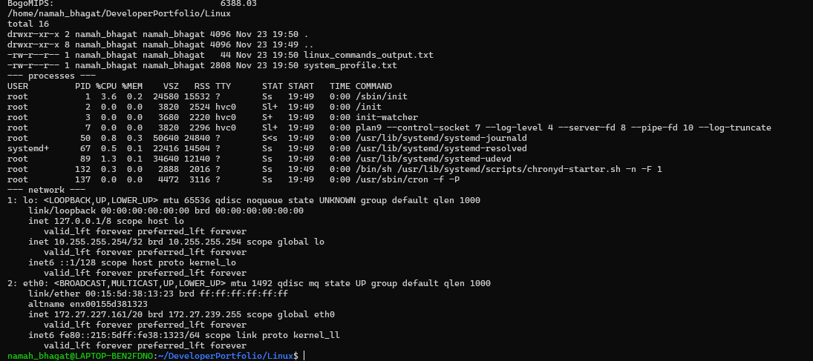
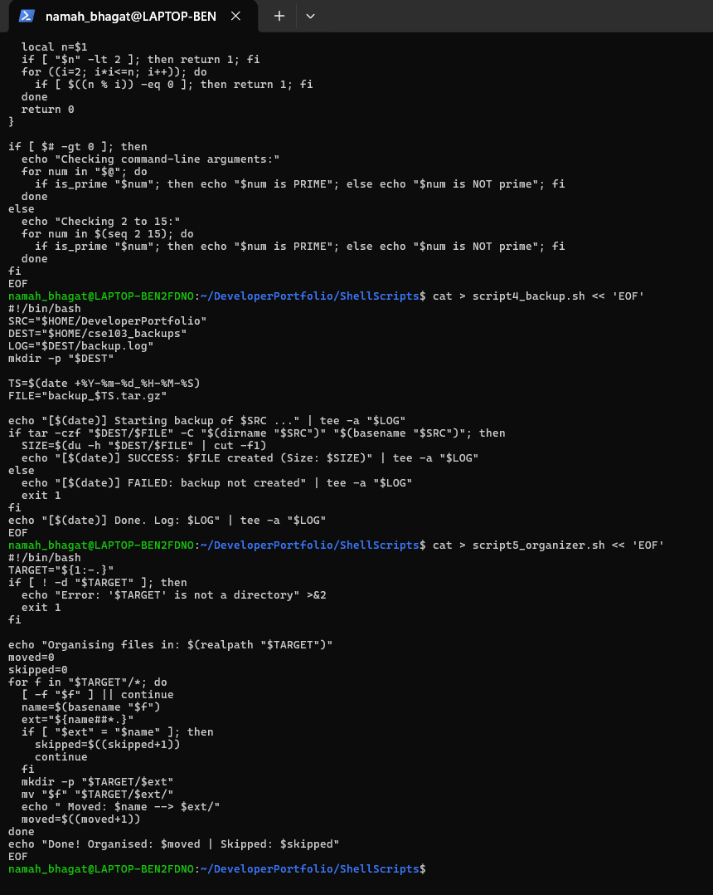
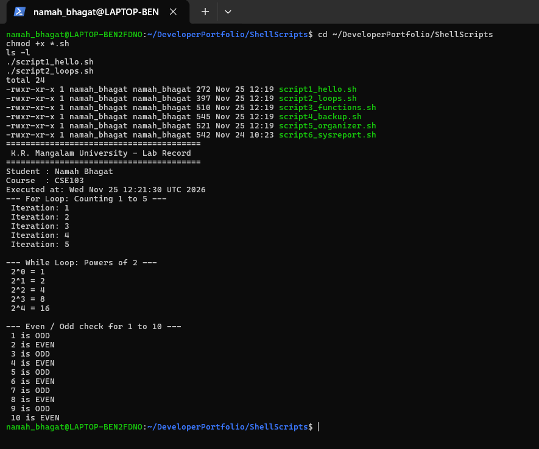
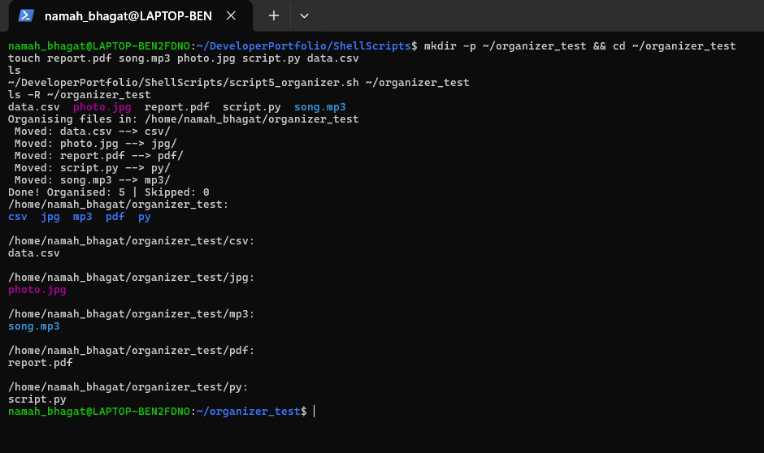
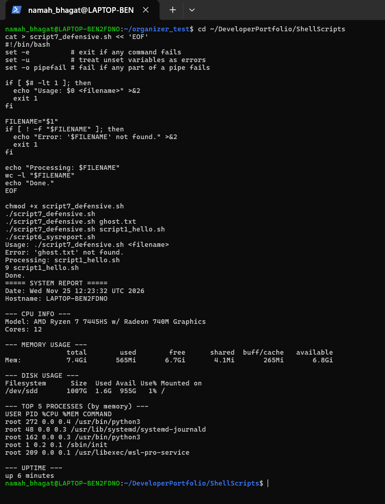
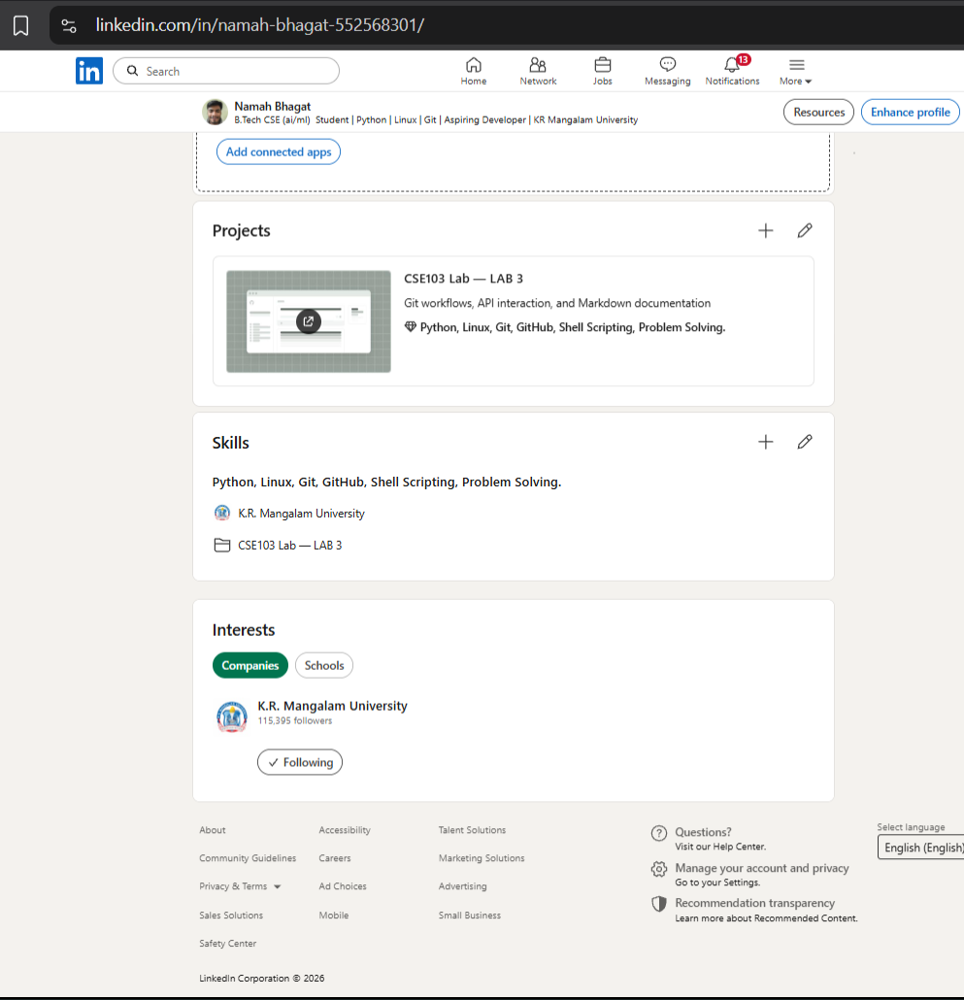
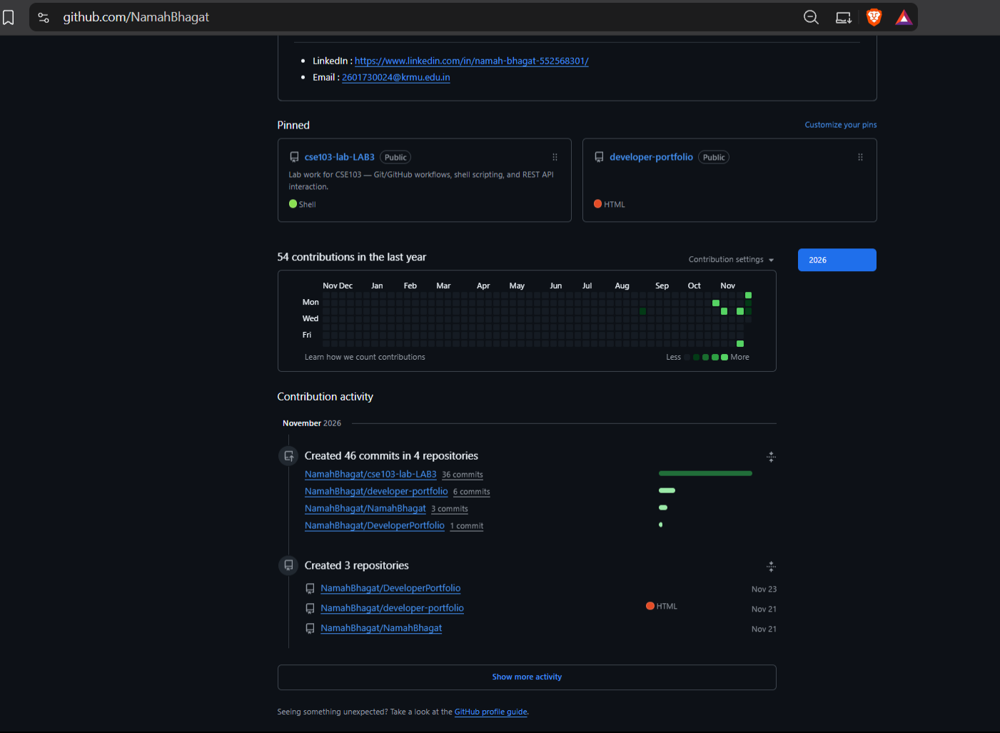
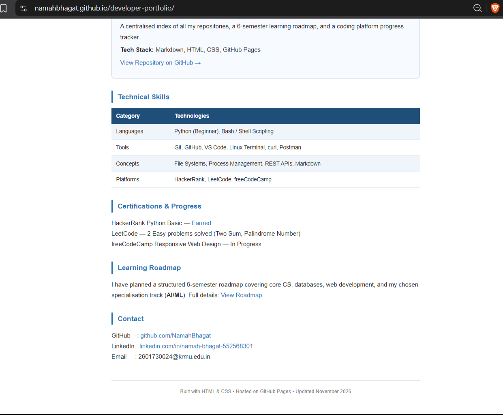

# Developer Portfolio

**Name:** Namah Bhagat | **Roll No:** 2601730024
**Course:** B.Tech CSE (AI/ML), K.R. Mangalam University, Gurugram (Batch 2026-30)

## Project Overview
This is my Beginner Developer Ecosystem Portfolio for the CSE103 capstone. It collects evidence from all four labs: Linux commands and system documentation, shell scripting, Git with API interaction, and a professional portfolio (resume, LinkedIn, GitHub and learning roadmap).

## Repository Structure
| Folder | Question | Content |
|---|---|---|
| `Linux/` | Q1 - CO1 | System profile, Linux command outputs, lab records |
| `ShellScripts/` | Q2 - CO2 | Bash automation scripts and lab records |
| `API/` | Q3 - CO3 | API response JSON, Python script, Git/Markdown lab records |
| `Portfolio/` | Q4 - CO4 | Resume PDF, learning roadmap, LinkedIn screenshot, lab records |
| `Screenshots/` | Supporting | Screenshots for all sections |
| `README.md` | Overview | This file |

## What I Did in Each Section
- **Linux (CO1):** Collected system information (OS, CPU, memory, disk) and practised file management, text processing and permissions.
- **Shell Scripts (CO2):** Wrote Bash scripts using variables, loops, functions, arguments, backups, file organising and defensive error handling.
- **API (CO3):** Used Python and the GitHub REST API to fetch profile data and save it as JSON. Practised Git, GitHub and Markdown in the `cse103-lab-LAB3` repository.
- **Portfolio (CO4):** Built a one-page ATS-friendly resume, a 6-semester learning roadmap, a GitHub profile and a LinkedIn profile.

## How to Run
```bash
chmod +x ShellScripts/*.sh
./ShellScripts/script1_hello.sh
./ShellScripts/script3_functions.sh 7 11 15 23
./ShellScripts/script6_sysreport.sh
python3 API/fetch_github.py
```

## Screenshots










## Links
- GitHub: https://github.com/NamahBhagat
- LinkedIn: https://www.linkedin.com/in/namah-bhagat-552568301/
- Portfolio website: https://namahbhagat.github.io/developer-portfolio
- Lab 3 repository: https://github.com/NamahBhagat/cse103-lab-LAB3
- Portfolio index repository: https://github.com/NamahBhagat/developer-portfolio
- HackerRank: h2601730024 | LeetCode: NamahBhagat
- Email: 2601730024@krmu.edu.in

## Skills
Linux, Bash, Git/GitHub, Python (Beginner), REST APIs, Markdown
