# Developer Portfolio

**Name:** Namah Bhagat | **Roll No:** 2601730024
**Course:** B.Tech CSE (AI/ML), KR Mangalam University, Gurugram (Batch 2026-30)

- GitHub: https://github.com/NamahBhagat
- LinkedIn: https://www.linkedin.com/in/namah-bhagat-552568301/
- Live Website: https://namahbhagat.github.io/DeveloperPortfolio

## Project Overview
This is my CSE103 capstone. It collects work from four sections: Linux, Shell Scripting, GitHub and API, and Developer Portfolio.

## Repository Structure
| Folder | Question | Content |
|---|---|---|
| Linux/ | Q1 | System profile and Linux command outputs |
| ShellScripts/ | Q2 | sysinfo.sh and backup.sh |
| API/ | Q3 | GitHub and JSONPlaceholder API data and summary |
| Portfolio/ | Q4 | Resume and learning roadmap |
| Screenshots/ | Supporting | Screenshots of all sections |

## Q1: Linux
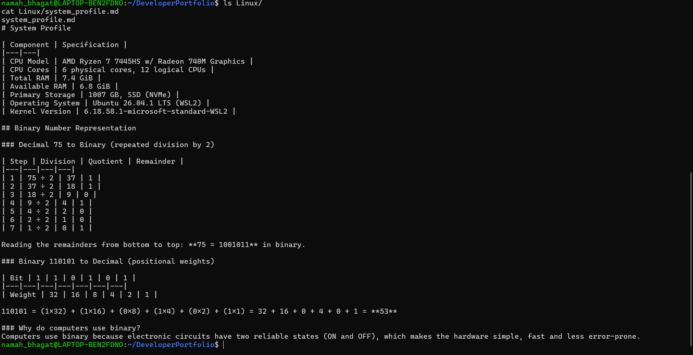
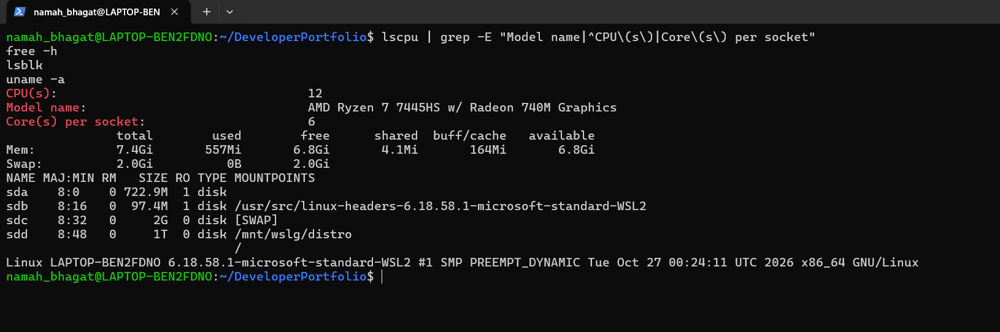
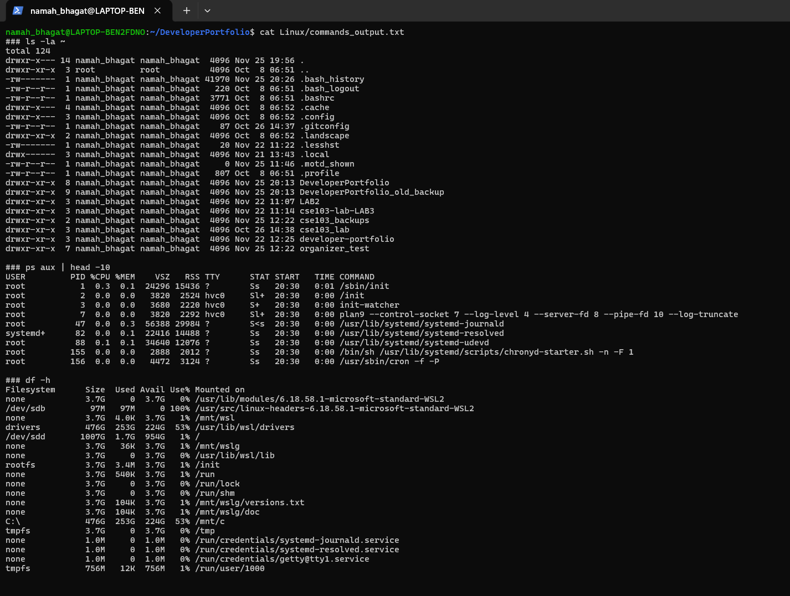
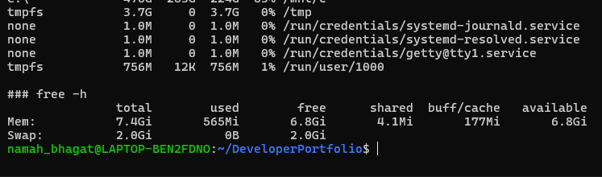

## Q2: Shell Scripting
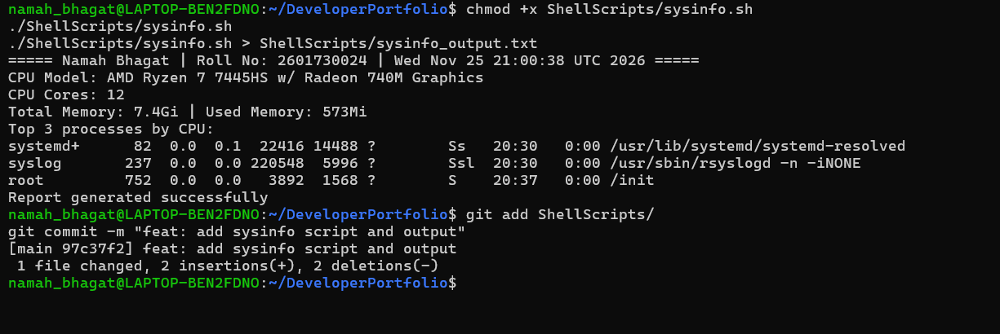
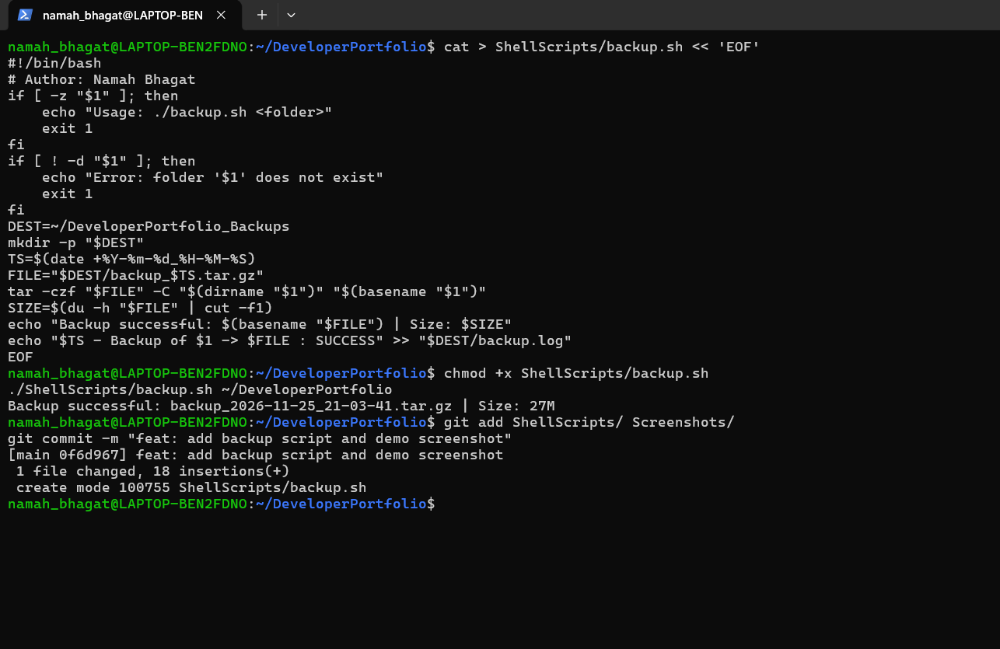

## Q3: GitHub and API
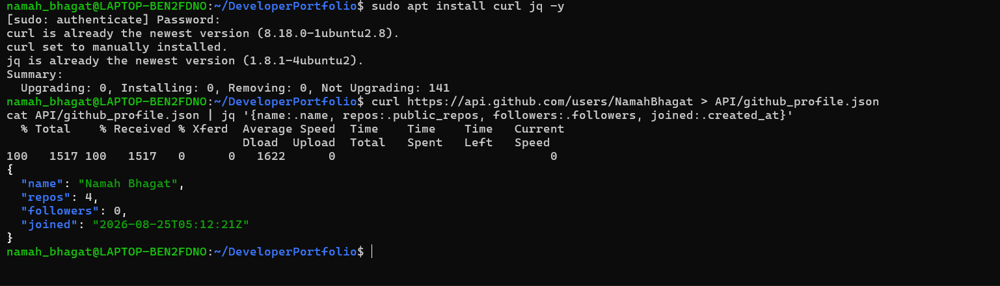
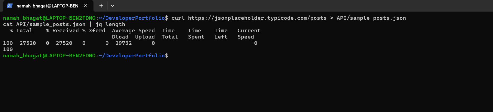
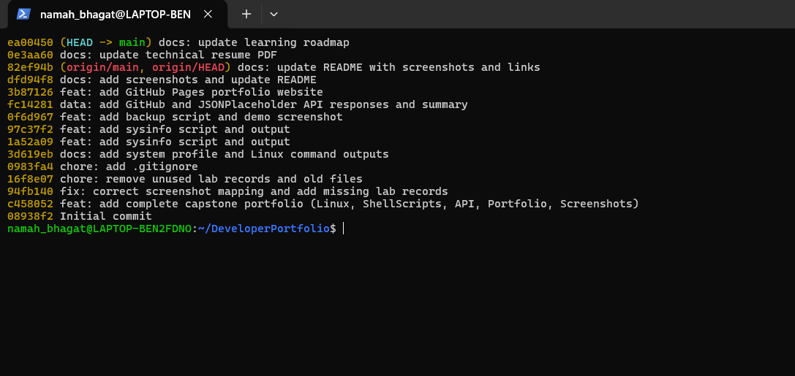

## Q4: Developer Portfolio
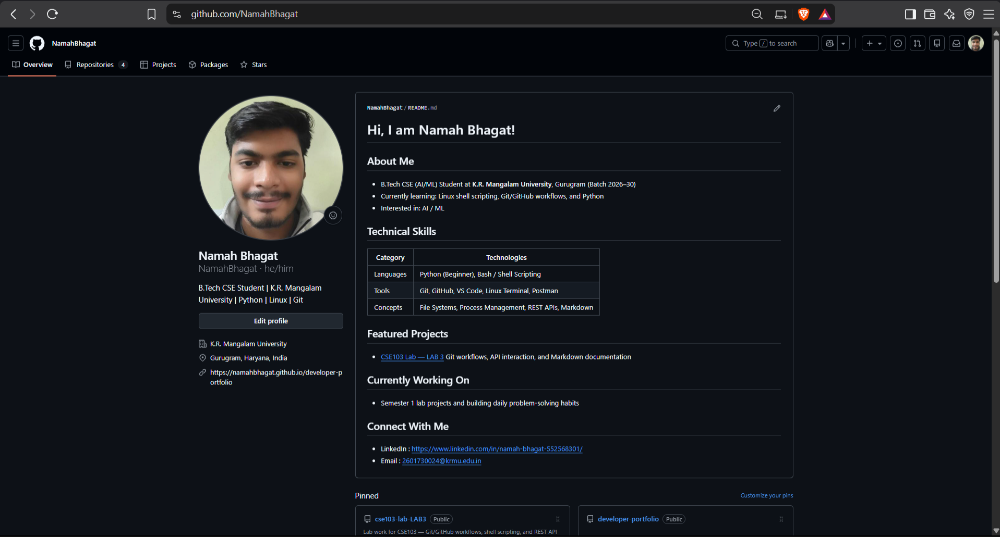
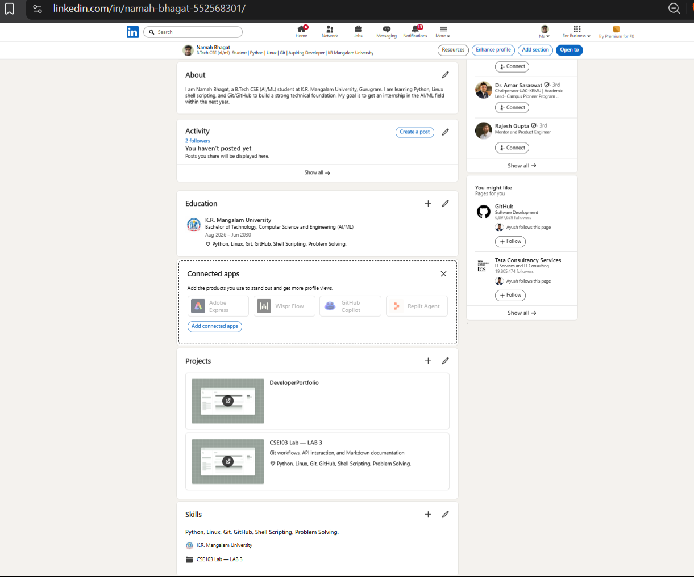
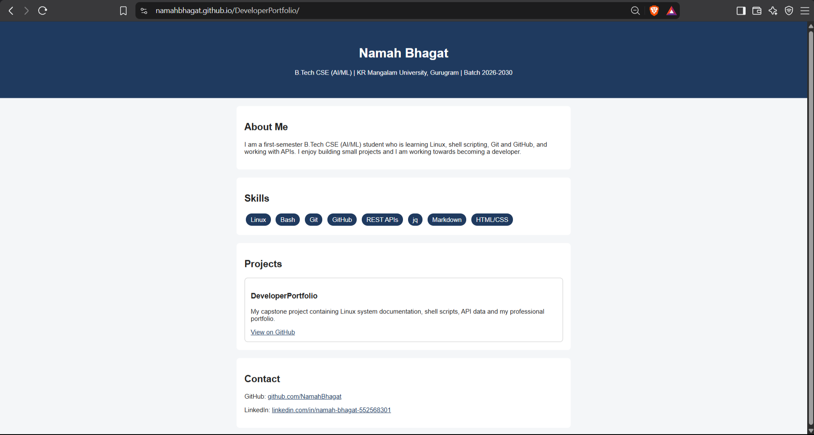
